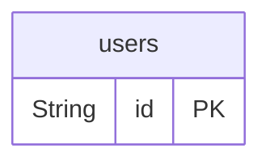
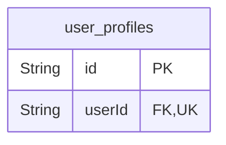
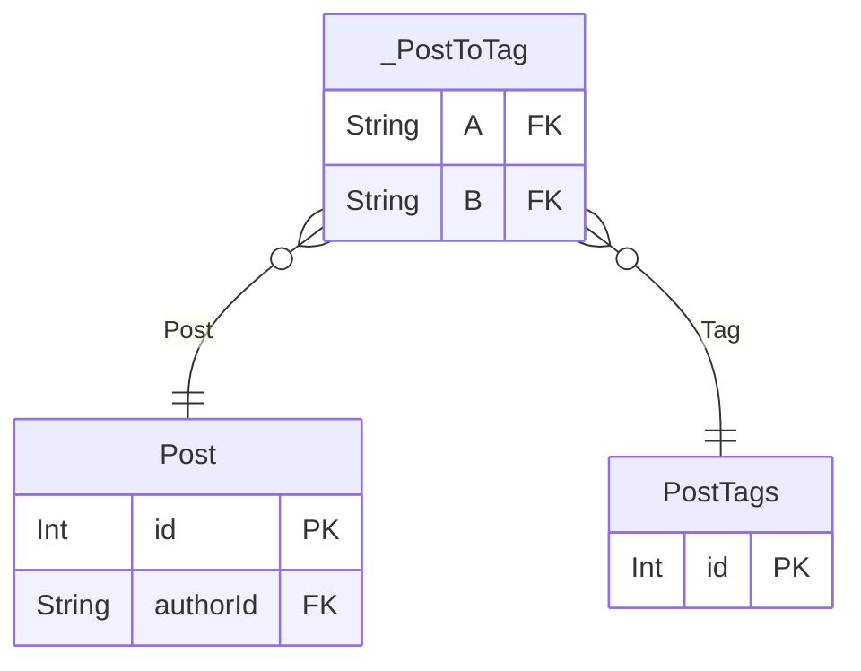

# Link References

> Generated by [`prisma-markdown`](https://github.com/samchon/prisma-markdown)

- [Accounts](#accounts)
- [Profiles](#profiles)
- [Articles](#articles)

## Accounts

### `users`

Owns many [posts](#post); see also [UserProfile](#user_profiles).
Legacy [users](#users); identifier [user identifier](#users).

Properties as follows:

- `id`:

## Profiles

### `user_profiles`

Profile of [User](#users).

Properties as follows:

- `id`:
- `userId`:

## Articles

### `Post`

Posts by [users](#users).

Tagged with [tags](#posttags) through [_PostToTag](#_posttotag).

Properties as follows:

- `id`:
- `authorId`
  > Identifier of [User](#users).
  >
  > Author [User.id](#users).

### `PostTags`

Tags for [Post](#post).

Properties as follows:

- `id`:

### `_PostToTag`

Pair relationship table between [Post](#post) and [PostTags](#posttags)

Properties as follows:

- `A`:
- `B`:
